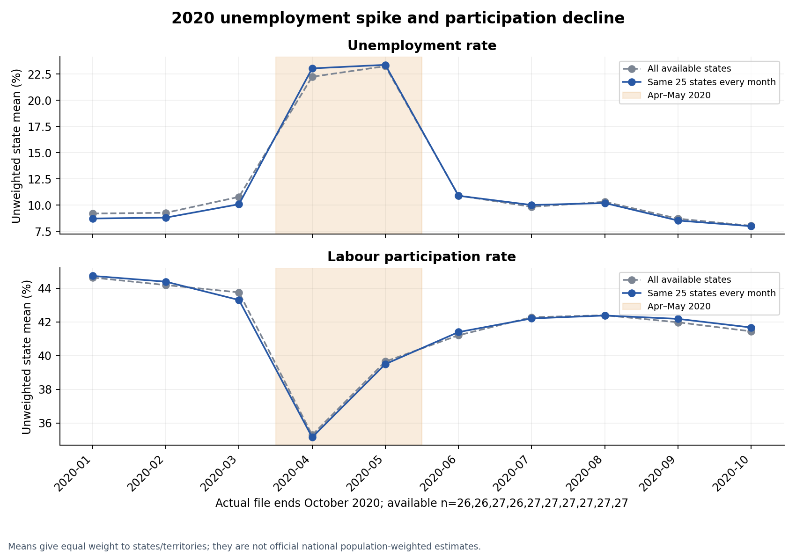
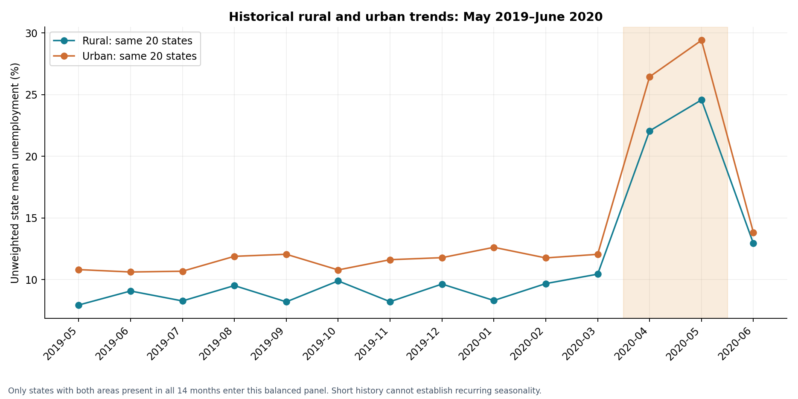

# Unemployment Analysis with Python

Explore unemployment trends across Indian states and rural/urban areas using Python data cleaning and visualizations. The project compares pre-Covid, lockdown-period, and later 2020 patterns, with policy insights and clear limits on national and causal claims.

The two user-supplied datasets have different observation units and stay separate throughout. No model, causal effect, or nationwide population-weighted estimate is claimed.

## Run

Python 3.12 was used for the included outputs. Create and activate a virtual environment using your platform's standard command, then:

```bash
python -m pip install -r requirements.txt
python analysis.py
```

The script resolves `data/` and `outputs/` relative to its own location, so it also works from another working directory. No network access is needed after dependencies are installed. Optional custom directories:

```bash
python analysis.py --data-dir /path/to/data --output-dir /path/to/results
```

`analysis.ipynb` offers an interactive entry point in a Python Jupyter environment. It imports the same analysis implementation, reruns the pipeline, and displays the report and charts. The CLI is the minimal, pinned-dependency reproduction route.

## Data

| File | Observation unit | Actual coverage | Cleaning |
| --- | --- | --- | --- |
| `data/Unemployment in India.csv` | State/territory × Rural/Urban × month | May 2019–June 2020, 740 valid rows | Remove 28 fully blank rows; trim headers/strings; strict type and key checks |
| `data/Unemployment_Rate_upto_11_2020.csv` | State/territory × month, with macro-region | January–October 2020, 267 rows | Trim headers/strings; distinguish the two Region columns; strict type and key checks |

The second filename suggests November, but there are no November observations. The source coordinate labels appear swapped; they are retained with `source_*_label` names and are not used for mapping. The two files are not concatenated, and missing rates are never filled with zero or imputed.

Actual analysis inputs are the two user-uploaded CSV files. The task PDF's dataset link points to [Unemployment in India on Kaggle](https://www.kaggle.com/datasets/gokulrajkmv/unemployment-in-india). This is task-document attribution; the uploaded files' original publisher, survey methodology, extraction date, and license were not independently verified. No ownership or data license is asserted.

## Method

- Descriptive summaries, coverage tables, and state-month visualizations.
- State comparisons use the same complete panel for Jan–Mar 2020, Apr–May 2020, and Aug–Oct 2020. Monthly charts show the balanced panel alongside all available observations.
- Rural/urban comparisons require the same states in both areas. A full historical panel supports trends, and a separately documented January–June panel supports period comparisons.
- All aggregate rates are **unweighted state/territory or state-area means**, not official national population-weighted rates. Changes are percentage points.
- Participation rates are considered alongside unemployment. Covid timing is an association; no causal estimate is identified.
- May 2019–June 2020 is too short to establish repeated seasonality. Only observed within-year monthly variation is reported.

## Results and report

Read the complete [design report](outputs/summary.md), including data coverage, methods, results, policy insights, limitations, and reproducibility. Machine-readable results are in [metrics.json](outputs/metrics.json).





## Outputs

- `outputs/summary.md`: standard design report with six figures.
- `outputs/metrics.json`: exact metrics, panel membership, validations, and source SHA-256 hashes.
- `outputs/cleaned_*.csv`: cleaned copies; original datasets remain unchanged.
- `outputs/tables/`: descriptive statistics, exact coverage/missingness, monthly means, paired state changes, regional comparisons, and matched rural–urban gaps.
- `outputs/charts/`: six readable PNG figures generated with Matplotlib's headless Agg backend.

## Validation

The pipeline rejects partial missing required fields, duplicate keys, invalid dates/frequencies, non-finite numbers, rates outside 0–100%, and negative/fractional employment counts. It explicitly checks that all paired comparisons have complete months and that panel membership remains constant.

The included outputs were generated by running `python analysis.py`; see the report and machine-readable validation status. Re-run that command after replacing data: changed schemas or ambiguous observations fail explicitly instead of silently changing the analysis.

## Report exports

- [Formatted design report](REPORT.md)
- [PDF report](report/report.pdf)
- [Editable DOCX report](report/report.docx)

The committed notebook contains outputs from a successful full execution. The included GitHub Actions workflow reproduces the analysis on Python 3.12. View the Actions tab for the current GitHub run status.

## Submission downloads

- [Complete four-project submission package](https://raw.githubusercontent.com/nisa3131/CodeAlpha_IrisFlowerClassification/main/submission/CodeAlpha_DataScience_Submission.zip)
- [Combined PDF report](https://raw.githubusercontent.com/nisa3131/CodeAlpha_IrisFlowerClassification/main/submission/CodeAlpha_DataScience_Design_Report.pdf) · [Editable Word report](https://raw.githubusercontent.com/nisa3131/CodeAlpha_IrisFlowerClassification/main/submission/CodeAlpha_DataScience_Design_Report.docx)
- [Submission checklist](https://raw.githubusercontent.com/nisa3131/CodeAlpha_IrisFlowerClassification/main/submission/SUBMISSION_CHECKLIST.pdf) · [Video explanation scripts](https://raw.githubusercontent.com/nisa3131/CodeAlpha_IrisFlowerClassification/main/submission/VIDEO_EXPLANATION_SCRIPTS.md)
- [Download this project as a ZIP](https://github.com/nisa3131/CodeAlpha_UnemploymentAnalysis/archive/refs/heads/main.zip)

The complete package includes the four projects, executed notebooks, datasets, results, charts, individual reports, the combined report, and submission guidance. The shared downloads are hosted in the Iris repository's `submission/` folder. Record/post the required explanation videos and complete the official submission form separately.
